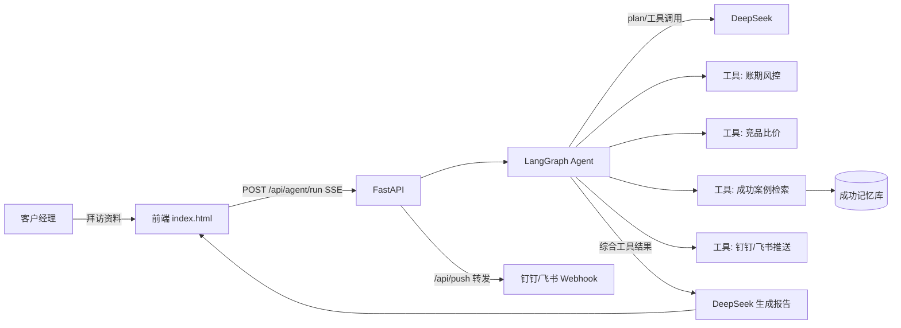

# 客户经理 AI 作战台（Customer Manager AI Workbench）

面向牧原生鲜行业客户经理的 **AI 智能体 + RAG 应用**：把客户拜访录音/文本自动转化为 **结构化拜访总结、账期风险风控、竞品比价、相似客户推荐与销售话术**。

- 后端：**FastAPI + LangGraph + DeepSeek**，function calling 驱动的 Agent，SSE 流式输出思考过程
- 前端：完整业务系统（拜访助手 / 找客户+地图 / 成功记忆 RAG / 数据看板 / 我的资料）+ Agent 技术演示页
- 双模式：配置 `DEEPSEEK_API_KEY` 走真实模型；未配置自动回退规则引擎（离线可用、零成本演示）

---

## 功能总览

| 模块 | 说明 |
| --- | --- |
| 🗂 拜访助手 | 导入录音/Word/文本 → AI 总结、客户画像、账期风控、竞品比价、待办、话术（真实 Agent 流式） |
| 🛡 账期风控 | 付款方式/账期/欠款/逾期识别，风险评分四级（低/中/高/极高），催收待办 |
| ⚖ 竞品比价 | 解析竞品公司/品项/价格/账期，计算**含账期资金成本的综合价差** |
| 🎯 成功记忆（RAG） | 成功案例自动沉淀 → 特征向量检索（接口预留 pgvector）→ 相似客户 + 话术 |
| 🗺 找客户 + 地图 | 高德地图（Leaflet）区域拓客、滞销品承接客户紫色标注 |
| 📊 数据看板 | 角色自适应：客户经理"个人复盘"，区域/大区经理"管理驾驶舱"（区域风险排名） |
| 📢 推送 | 钉钉/飞书 Webhook，**服务端 `/api/push` 转发**（绕过浏览器 CORS），高优待办自动推送 |
| 🎨 主题 | 5 套可切换风格（牧原绿 / 深色驾驶舱 / 商务蓝 / 暖金晨曦 / 极简黑白） |

## 架构



**Agent 工作流（LangGraph StateGraph）**：`parse（解析）→ plan（DeepSeek 规划工具）→ execute（执行工具）→ synthesize（综合生成 JSON 报告）`，有工具调用则回到 plan 继续，SSE 流式把每步思考推给前端。

## 技术栈

- Python 3.11+ / FastAPI / Uvicorn / Pydantic
- **LangGraph** / LangChain / langchain-openai（DeepSeek，function calling + JSON 输出）
- RAG：本地特征向量 + 余弦相似度（`backend/app/memory.py`，接口按 pgvector 预留）
- 前端：原生 HTML/JS（无框架）、Leaflet + 高德瓦片、SSE 流式
- 存储：JSON 文件（原型）；正式版换 PostgreSQL + pgvector

## 快速开始

```bash
# 1. 启动后端（LangChain 导入较慢，首次约 20-40 秒）
cd backend
pip install -r requirements.txt
cp .env.example .env   # 填入 DEEPSEEK_API_KEY（不配也能跑，走规则模式）
python -m uvicorn app.main:app --port 8000

# 2. 打开前端
# 直接用浏览器打开 frontend/index.html（演示进入）
# 或打开 frontend/agent-demo.html 看 Agent 技术演示
```

> 前端可部署到 **GitHub Pages** 静态托管（地图在线可用；Agent 后端需本地或服务器运行，未连接时自动回退规则模式）。

## 钉钉 / 飞书推送

1. 钉钉群 → 添加自定义机器人（安全设置关键词填 `作战台`）或飞书群 → 自定义机器人
2. 复制 Webhook，填入 前端「我的资料 → 待办推送接口」
3. 保存后，高优先级待办 / 账期预警自动推送（优先经后端 `/api/push` 服务端转发）

## API

| 接口 | 方法 | 说明 |
| --- | --- | --- |
| `/api/health` | GET | 健康检查，返回 `llm_mode: deepseek/rule` |
| `/api/agent/run` | POST | 运行 Agent，SSE 流式（thinking/tool_start/tool_end/result） |
| `/api/cases` | GET/POST | 成功案例库增查 |
| `/api/cases/{id}` | DELETE | 删除案例 |
| `/api/push` | POST | 服务端转发消息到钉钉/飞书 |

## 目录结构

```
├── frontend/
│   ├── index.html          # 主程序（完整业务系统）
│   ├── agent-demo.html     # Agent 技术演示页（流式思考过程）
│   ├── 测试文本集.html/.md # 10 组功能测试文本（含多人对话）
│   └── assets/             # 素材、Leaflet、jszip
├── backend/
│   ├── app/
│   │   ├── main.py         # FastAPI + SSE + 案例库 + 推送转发
│   │   ├── agent.py        # LangGraph StateGraph 智能体
│   │   ├── llm.py          # DeepSeek 客户端（真实/规则双模式）
│   │   ├── tools.py        # 工具：账期风控/比价/检索/推送
│   │   └── memory.py       # 成功记忆库 + 特征向量检索（预留向量库接口）
│   ├── data/success_cases.json  # 成功案例种子数据
│   ├── requirements.txt
│   └── .env.example
└── README.md
```

## Roadmap

- [ ] 存储升级：JSON → PostgreSQL + pgvector，真向量检索（embedding API）
- [ ] Excel 导入真实客户台账 / 订单数据，地图与账龄真实化
- [ ] 登录认证 + RBAC（客户经理 / 区域经理 / 大区经理 / 项目部负责人）
- [ ] 评估（evals）：总结质量、检索召回、话术评分
- [ ] Docker 化 + GitHub Actions CI/CD
- [ ] 语音转写（ASR）、移动端适配

## License

MIT